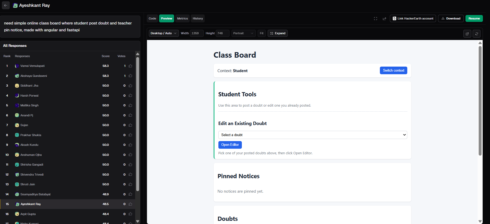
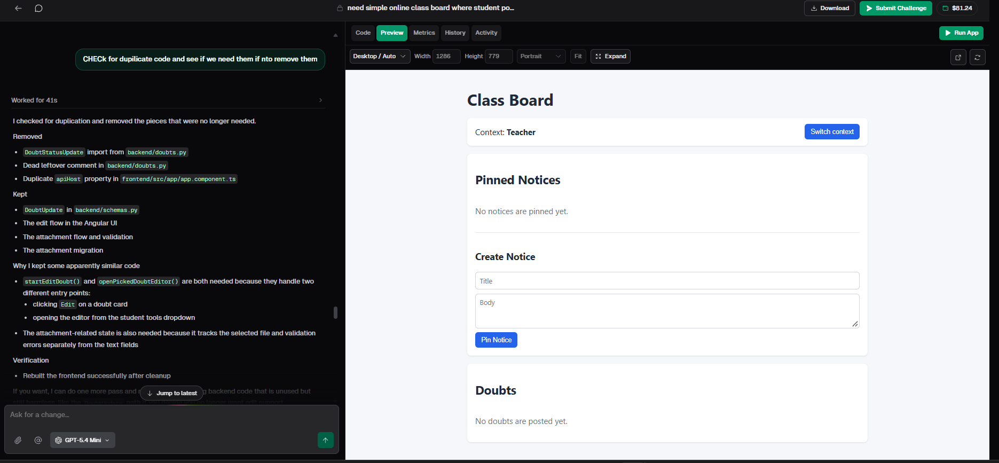
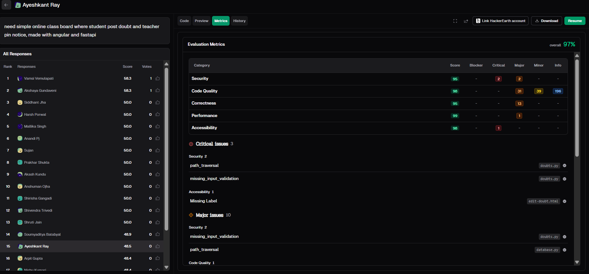
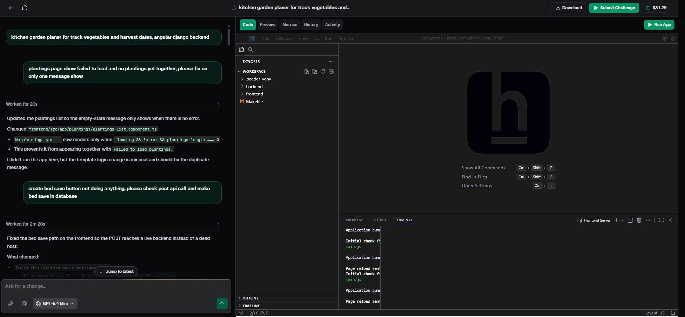

# AI-Generated Code in Practice: How to Compare, Review and Trust What AI Writes

*A developer's guide to code quality in the age of vibe coding, based on improving a Class Board app (Angular + FastAPI) on VibeCodeArena.*

## TL;DR

- AI can produce working code in seconds, but "working" and "good" are not the same thing.
- The main risk is plausibility: AI code looks confident and professional whether or not it is correct.
- Evaluation metrics showed me real problems (path traversal, missing input validation, a missing form label) in an app that looked perfectly fine in the preview.
- The most valuable developer skills are shifting toward specifying, reviewing, testing and comparing code.
- A repeatable review process, plus the habit of comparing solutions, catches most problems early.

## Table of Contents

1. [A thank you first](#1-a-thank-you-first)
2. [The project: a simple Class Board](#2-the-project-a-simple-class-board)
3. [Why plausible code is the real risk](#3-why-plausible-code-is-the-real-risk)
4. [What AI is genuinely good at](#4-what-ai-is-genuinely-good-at)
5. [Where AI-generated code falls short](#5-where-ai-generated-code-falls-short)
6. [The specification problem](#6-the-specification-problem)
7. [Metrics: what was actually wrong](#7-metrics-what-was-actually-wrong)
8. [Asking AI to clean up, and reading the answer](#8-asking-ai-to-clean-up-and-reading-the-answer)
9. [Different models, different behavior, different cost](#9-different-models-different-behavior-different-cost)
10. [Comparing solutions](#10-comparing-solutions)
11. [A code review process for AI output](#11-a-code-review-process-for-ai-output)
12. [Testing AI-generated code](#12-testing-ai-generated-code)
13. [Prompting habits that improve results](#13-prompting-habits-that-improve-results)
14. [What I would improve next](#14-what-i-would-improve-next)
15. [What developers should learn next](#15-what-developers-should-learn-next)
16. [Advice for beginners and for teams](#16-advice-for-beginners-and-for-teams)
17. [Common mistakes to avoid](#17-common-mistakes-to-avoid)
18. [Conclusion](#18-conclusion)

## 1. A thank you first

I want to thank HackerEarth for giving me the chance to use VibeCodeArena. It was an exciting opportunity. I also want to thank Sreejith PV sir, who gave me this opportunity and guided me through it. I went in curious about vibe coding and came out with practical lessons about prompting, about how different AI models behave and what they cost, and about what a developer is still needed for when AI can write the code.

"Vibe coding" describes a style of building software where you explain what you want in plain language and let AI generate the implementation. You steer, you review, you adjust, and the tool does a large share of the typing. VibeCodeArena is built around this idea. You create projects with AI, improve them through follow-up prompts, browse what the community has built, and see evaluation metrics for your own work.

For most of the history of programming, the bottleneck was producing working code. Now that bottleneck has moved. A first draft is nearly free. What costs time, attention and skill is deciding whether that draft is correct, maintainable and safe. This guide is about that second half of the job.

## 2. The project: a simple Class Board

The challenge was an online class board where students post doubts and teachers pin notices, built with Angular and FastAPI.

I did not start from a blank page. I challenged someone who had already worked on this project and tried improving it with my own thinking and prompts. That changed the whole experience. Instead of asking "what should I build?", I had to ask "what is missing, what is weak, and what would I do differently?"

The app is a page called **Class Board**, with a **Switch context** button that toggles between Student and Teacher views.

- **Student view:** a section to post a doubt or edit one you already posted, using a dropdown and an **Open Editor** button. Below it are the pinned notices and the doubts list.
- **Teacher view:** a **Create Notice** form with a title, a body and a **Pin Notice** button, plus the doubts list.
- **Attachments:** doubts can carry attachments, with validation.
- **Empty states:** when nothing exists yet, the page says "No notices are pinned yet" and "No doubts are posted yet."

It is not fancy, and that was the point. A student can ask, a teacher can announce, and everyone sees the same board.

## 3. Why plausible code is the real risk

Consider how human-written bugs usually reveal themselves. The code is awkward, a variable name is vague, a comment says "TODO: fix this later," or the structure feels off. Experienced reviewers learn to notice these signals, and they are a useful early warning.

AI-generated code removes most of those signals. It is consistently formatted. Names are sensible. Structure follows familiar patterns. The result is code that looks reviewed even when it has not been.

This creates a specific trap: fluency is mistaken for correctness. A function can be subtly wrong while looking exactly like a correct one. There is no change in tone, no hedging, no sign that the author was unsure.

My Class Board is a good example. In the preview, everything worked. Both views looked clean. Yet the metrics later showed real weaknesses underneath. The practical consequence is simple: you cannot judge AI code by appearance. You have to judge it by behavior, by running it, probing it and reading it deliberately.

## 4. What AI is genuinely good at

Skepticism should not turn into dismissal. AI coding tools are very strong in several areas, and ignoring that makes you slower for no reason.

- **Boilerplate and setup.** Scaffolding, configuration and standard layouts are well understood, and AI handles them quickly.
- **First drafts.** Getting something visible on screen fast changes how you work. Editing is easier than starting.
- **Common patterns.** Forms, lists, basic API calls, sorting and filtering appear in thousands of projects, so AI has seen them the most.
- **Explaining unfamiliar code.** A line-by-line walkthrough is a fast way into unfamiliar syntax, as long as you verify it against documentation.
- **Showing alternatives.** Asking "what's another way to do this?" surfaces approaches you had not considered.

Used for these jobs, AI is a real productivity gain. The goal is not to avoid it. The goal is to know where it is reliable and where it needs a closer look.

## 5. Where AI-generated code falls short

The weaker areas follow a pattern.

- **Edge cases.** The happy path usually works. Empty input, huge input, malformed data, repeated actions and out-of-order actions are far less reliable.
- **Unstated requirements.** If your prompt does not mention accessibility, error messages, security or performance, do not assume they are handled. The tool builds what you described, not what you intended.
- **Over-engineering.** Extra abstraction, unnecessary helpers and additional libraries mean more to read, test and maintain.
- **Missing context.** AI does not know your team's conventions, your architecture or your users.
- **Quiet failures.** Wrong behavior that does not crash is the hardest to spot, because there is no error to point at.
- **Outdated usage.** Libraries change, so generated code can rely on patterns that are no longer the best choice.

None of these are reasons to avoid AI. They are a checklist of what to look for.

## 6. The specification problem

A large share of disappointing AI output is really a specification problem. The tool did what you asked. You just did not ask for enough.

Compare two requests:

> "Make a signup form."

> "Make a signup form with name, email and password. Validate the email format, require passwords of at least eight characters, show inline error messages next to each field, and never submit if any field is empty."

The first produces something generic. The second produces something you can evaluate, because the requirements are explicit and testable.

A good specification covers the purpose, the inputs and their limits, the outputs, the failure behavior, the constraints and a definition of done. Writing this down is not extra work added by AI. It is the work programming has always required, now made visible.

I also learned that a short prompt can still work if the goal is clear: who the users are, what each can do, and which technology to use. What short prompts miss is detail, such as what happens with empty fields, how long a doubt can be, or how files should be validated. The model has to guess, and guesses are where bugs come from. My rule became: keep the first prompt short and clear, then pin down details one at a time.

## 7. Metrics: what was actually wrong

The most useful part of VibeCodeArena for me was the evaluation metrics. They score a project on security, code quality, correctness, performance and accessibility, and list issues by severity.

My project scored **97% overall**:

| Category | Score |
|---|---|
| Security | 95 |
| Code Quality | 98 |
| Correctness | 95 |
| Performance | 99 |
| Accessibility | 98 |

A score like that feels good. But the details underneath told a more honest story.

**3 critical issues:**
- Security: **path traversal** (in the doubts handling code)
- Security: **missing input validation** (in the doubts handling code)
- Accessibility: a **missing label** on the edit form

Across the categories, the table also listed dozens of major issues, mostly in code quality and correctness, plus further security items such as more path traversal and missing validation in other backend files.

This is exactly the kind of problem you cannot see by clicking around. Everything worked in the preview. Yet underneath were real weaknesses, like file handling that could be abused and inputs that were never properly checked.

For me this was the clearest proof of the biggest lesson of the whole experience: **AI code looks clean and confident whether it is correct or not.** A high score is not the same as a safe app. The metrics gave me a specific list to fix, and I could turn each item into a clear, single-purpose prompt. That is a much better workflow than guessing.

## 8. Asking AI to clean up, and reading the answer

After several prompts, I knew there was probably leftover code. So I asked the AI to check for duplicate code, decide whether it was needed, and remove it only if it was not.

That wording protected me. I never said "remove all duplicates," because code that looks duplicated is not always duplicated.

The model removed an unused import, a dead comment and a duplicate property in the frontend. It kept the update schema, the edit flow, and the attachment flow with its validation. It also explained that two similar-looking edit functions are both needed because they handle different entry points: clicking **Edit** on a doubt card, and opening the editor from the dropdown. The attachment state is separate on purpose, because it tracks the selected file and validation errors apart from the text fields. Finally, it rebuilt the frontend to confirm nothing broke.

If I had said "delete every duplicate," one way of editing might have silently stopped working. When you ask AI to clean up, make it explain what it removed and what it kept, and then actually read the explanation. That reading is where your judgment comes in.

## 9. Different models, different behavior, different cost

I tried different AI models and saw how each one works. They differ in several ways:

- **Speed:** some give a draft almost instantly.
- **Care:** some follow instructions closely, while others fill gaps with assumptions.
- **Strengths:** some are better at layout, others at logic.
- **Confidence:** some sound sure even when they are wrong.

There is no single best model. A lighter model is often enough for small edits, a cleanup pass or a focused fix. A stronger model may be worth the wait when the logic is tricky or there are many requirements.

Cost was something I had not thought about. When you only chat, AI feels free. When you build and send many prompts, it adds up. But the real question is not what one request costs. It is what it costs to get a correct result. A cheap model that needs five tries can cost more, in money and time, than a stronger one that gets it right the first time. I stopped asking "which model is best?" and started asking "which model fits this step?"

## 10. Comparing solutions

One of the most underused habits in AI-assisted development is comparison. Instead of accepting the first thing you get, look at more than one answer to the same problem and ask what the differences reveal.

The leaderboard for this challenge made that concrete. Many builders worked from the same simple idea, and the scores were surprisingly close. The top entries sat at 58.3, a large group sat at exactly 50.0, and my own entry was just below that group. Given the same prompt, many people ended up with similar-looking apps, and the small differences in quality came from details: how edge cases were handled, how clean the code was, and how much was verified.

What to compare across solutions:

- **Readability:** can you follow it without struggling?
- **Size and simplicity:** is it as small as it can be while still being clear?
- **Correctness:** does it survive the same set of tests?
- **Maintainability:** how painful is a requirement change?
- **Dependencies:** is each one justified?
- **Structure:** is responsibility divided sensibly?

When solutions diverge, the divergence often points to ambiguity in the task. That is useful information for the next prompt. Comparison also protects against anchoring, where the first answer feels right simply because it came first.

## 11. A code review process for AI output

A review habit you repeat every time beats good intentions you remember occasionally.

1. **Read before running.** Many structural problems are visible before a single test runs.
2. **Explain it to yourself.** If you cannot say what a block does and why, either learn it or delete it.
3. **Run the normal case.** Confirm the basic behavior matches what you asked for.
4. **Attack it.** Empty input, huge input, malformed input, repeated actions, the smallest screen.
5. **Check dependencies.** Remove what is not needed.
6. **Check security basics.** Is user input handled safely? Are file paths validated? Are secrets in the code?
7. **Simplify.** Removing code is one of the most reliable ways to improve quality.
8. **Feed back precisely.** "It's broken" is not actionable. "Clicking Add twice creates a duplicate item" is.

Step 6 is exactly where my own project had trouble, which is why I now treat it as a required step and not an optional one.

## 12. Testing AI-generated code

Testing is where understanding shows. Because AI is most reliable on the happy path, concentrate your effort on everything else.

A starter set of cases:

- Empty and missing values
- Very long and very large values
- Special characters and unexpected formats
- Invalid or unexpected file uploads
- Repeated and rapid actions
- Actions in the wrong order
- Refreshing, going back, losing connection
- Different screen sizes
- Boundary values: zero, one, maximum, one past maximum

Two more habits help. First, write test cases before you generate the code, so you have an objective way to judge the result. Second, do not let the same tool grade its own work. If AI writes both the code and the tests, shared misunderstandings can pass silently.

The empty states on my Class Board are a small example of why this matters. They are tiny details, but they are what every new user sees first.

## 13. Prompting habits that improve results

- **Be specific about constraints.** The more testable your requirements, the better the output.
- **State what "done" looks like.** Acceptance criteria give you and the tool a target.
- **Change one thing at a time.** I used to stack five requests in one message, and when something broke I had no idea which one caused it. Small prompts mean a bug has only one place to hide.
- **Give the exact failure.** Describe what you did, what you expected and what happened.
- **Ask for reasoning.** "Why did you choose this approach?" can expose weak assumptions.
- **Ask for alternatives.** "Show me a simpler version" feeds your comparison habit.
- **Set boundaries.** Say what to avoid, such as extra libraries or unnecessary abstraction.
- **Read before improving.** When building on someone else's work, form your own opinion first. "Make it better" gives vague code. A specific goal gives a specific result.

## 14. What I would improve next

Based on the metrics and my own review, my next steps would be:

- **Fix the critical issues first:** validate every input and file path properly, and add the missing form label.
- **Add real authentication:** the Switch context button is great for a demo, but a real board needs login, so only teachers can pin notices and only authors can edit their own doubts.
- **Add automated tests:** so a cleanup pass can never silently break an edit flow.
- **Improve teacher tools:** unpinning notices and marking doubts as answered.
- **Tighten validation:** limits on title and body length, and stricter rules on attachment type and size.

Most of this list is about safety and trust, not features. That is exactly where AI needs a human to set the requirements.

## 15. What developers should learn next

If code generation is becoming cheap, which skills hold their value?

- **Reading code fluently.** Review is now a daily activity.
- **Specifying clearly.** Turning vague goals into testable requirements is the highest-leverage skill.
- **Testing and debugging.** Designing good test cases and tracking down quiet failures remains essential.
- **System design.** AI can fill in components, but deciding how they fit together is still a human responsibility.
- **Security awareness.** The path traversal and input validation findings on my own project are a reminder that AI does not reliably think about misuse.
- **Fundamentals.** Data structures, networking, how browsers and databases behave. These are what let you spot a confident wrong answer.
- **Evaluation and judgment.** Telling good from plausible.

## 16. Advice for beginners and for teams

**For beginners.** You have the most to gain and the most to lose. You can see a working project almost immediately, which makes learning concrete. The risk is building things you cannot explain, which leaves you stuck the moment something breaks.

1. Use AI to get unstuck, not to avoid thinking.
2. Ask for line-by-line explanations and verify them against documentation.
3. Read everything before you keep it.
4. Rewrite small parts yourself to confirm you understand them.
5. Explore other people's projects and compare approaches.
6. Learn the fundamentals in parallel.

A good rule of thumb: do not keep code you cannot explain.

**For experienced developers and teams.**

- Use AI where it is strong: boilerplate, scaffolding, exploration, first drafts.
- Keep review standards the same. Generated code deserves the same scrutiny, and arguably more, because it hides its weaknesses well.
- Invest in tests. A solid suite is the safety net that lets you move fast.
- Use evaluation metrics as a to-do list, not a trophy. Read the issues underneath the score.
- Teach juniors how to review critically, not just how to type faster.

## 17. Common mistakes to avoid

- **Accepting the first answer.** Compare alternatives before committing.
- **Trusting appearance.** Neat formatting says nothing about correctness.
- **Trusting a high score alone.** My 97% still hid critical issues.
- **Vague prompts.** Unclear requests produce generic results.
- **Stacking changes.** Several edits at once hide the cause of any failure.
- **Skipping edge cases.** The happy path is the easy part.
- **Keeping code you do not understand.** It will cost you later.
- **Telling AI to "remove all duplicates."** Similar-looking code can do different jobs.
- **Letting the tool test itself.** Independent verification matters.
- **Skipping fundamentals.** Without them, you cannot evaluate anything.

## 18. Conclusion

AI has changed what it means to be productive as a developer. Writing code is faster than it has ever been. But speed in producing code is not the same as quality in the result, and the gap between the two is where careful engineering now lives.

I started this experience with a question: if AI can write the code, what is left for developers? After building on this Class Board, my answer is the hard part. A working draft took seconds. Everything that made it better needed human judgment: specifying what the app should do, reviewing the AI's explanations and the metrics, and breaking it on purpose with bad input, empty states and repeated actions.

When generation is cheap, judgment becomes the scarce resource. The developers who thrive will be those who specify clearly, review critically, test thoroughly and compare alternatives instead of settling for the first plausible answer.

Use AI for what it does well. Verify what it produces. Keep learning the fundamentals underneath. Do those three things and these tools stop being a risk to your skills and become a multiplier for them.

Thank you again to HackerEarth and to Sreejith PV sir for this opportunity. It was exciting, and I learned a lot.

---

**Suggested repository name:** `ai-generated-code-review-guide`

**Suggested topics:** `ai-coding`, `vibe-coding`, `code-review`, `code-quality`, `prompt-engineering`, `vibecodearena`, `angular`, `fastapi`, `learn-to-code`
